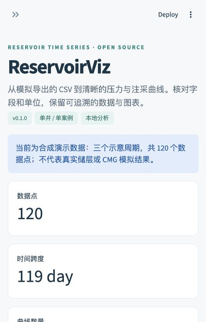

# ReservoirViz

**Inspect reservoir simulation time series, confirm units, and export interactive charts.**

[中文使用指南](docs/QUICKSTART_ZH.md) · [上传到 GitHub](docs/GITHUB_UPLOAD_ZH.md) · [Data format](docs/DATA_FORMAT.md) · [Roadmap](docs/ROADMAP.md)

ReservoirViz is a small open-source Python application for single-well or single-case CSV exports. It maps source columns to time, pressure, injection rate, and production rate, validates selected data, and creates interactive Plotly charts through a Streamlit interface. The current interface is in Chinese; plot labels and exported field names are in English.



## What v0.1.0 does

- Load UTF-8, GB18030, or BOM-marked UTF-16 CSV files up to 20 MB.
- Select source columns; configure the delimiter, decimal mark, and leading metadata rows.
- Check numeric values, missing values, duplicate times, and negative elapsed time.
- Convert elapsed time to days and pressure to MPa, using explicitly selected units.
- Preserve rate values and their units; use separate panels when rate units differ.
- Export a self-contained offline HTML report, normalized CSV, and JSON metadata with source SHA-256 and units.
- Try a clearly identified, synthetic three-cycle example without uploading a file.

Native CMG SR3 parsing, grid visualization, cumulative injection/production, and CO₂ storage calculations are outside this release. Compatibility with a specific CMG export must be checked against that file. No real CMG file was supplied for the initial validation.

## Quick start

Use **Python 3.12** (supported runtime range: 3.11–3.15). No Windows virtual machine, CMG license, API key, or paid cloud account is needed to run this CSV tool.

```bash
python3 -m venv .venv
source .venv/bin/activate
python -m pip install -r requirements.txt
python -m streamlit run app.py --server.address=127.0.0.1
```

On Windows, create the environment with `py -3.12 -m venv .venv` and activate it with `.venv\Scripts\activate.bat` in Command Prompt. Then use the same `python -m pip` and `python -m streamlit` commands.

Open <http://localhost:8501>. To stop the server, press **Ctrl+C** in the terminal.

Convenience launchers are also included:

- macOS: double-click `run_mac.command`, or run `bash run_mac.command` from the project directory.
- Windows: double-click `run_windows.bat`.
- Either platform: run `python run.py` with a supported Python interpreter.

The launcher creates `.venv`, installs dependencies on first run or when `requirements.txt` changes, and starts a local server. The initial setup needs internet access. Install Python first if the launcher reports an unsupported interpreter. Package installation errors are shown in the terminal.

## Use your data

1. Export one well or one case as a CSV with one header row and numeric elapsed time.
2. Choose **上传 CSV** in the sidebar and select the file.
3. Adjust CSV settings if the file has metadata rows or uses a different separator.
4. Map the time column and one or more measurement columns. Confirm units from the source software.
5. Review **数据与检查**; export the report and save the CSV together with its JSON metadata.

The app suggests some familiar field names. It never infers units from value magnitudes. `Sm³/day` records a standard-volume rate, but the source software defines the actual reference temperature and pressure. Selecting a rate unit labels the values; it does not convert mass to volume or change reference conditions.

## Example files

| File | Purpose |
|---|---|
| `examples/demo.csv` | 120 synthetic daily observations, three illustrative 40-day cycles |
| `examples/field_mapping_example.csv` | Synthetic data with alternative column names and hour/kPa units |
| `examples/README.md` | Provenance, schema, and expected mappings |

Both example files are generated examples, **not real measurements or validated simulation output**. They are distributed under the project's MIT license.

## Development and checks

```bash
python -m pip install -r requirements-dev.txt
python -m pytest -q
```

Tests cover malformed CSV rejection, text encodings, unit conversions, sorting, preserved signed rates, separate axes for incompatible units, offline exports, and Streamlit application rendering. See [VALIDATION.md](docs/VALIDATION.md) for the initial validation scope. The included GitHub Actions workflow runs checks after upload; no remote CI result is claimed until that workflow runs on your repository.

```text
app.py                  Streamlit interface
reservoirviz/data.py     Parsing, unit handling, validation
reservoirviz/charts.py   Interactive charts and offline HTML
examples/               Synthetic, reproducible input files
tests/                  Data, export, and app checks
docs/                   Guides, limitations, and roadmap
```

## Data handling

The application does not intentionally persist uploaded data or call an external AI/API service. In local mode, processing occurs on the computer running the server. If you host the app remotely, browser uploads are transmitted to that host; configure and assess the host accordingly. Streamlit usage telemetry is disabled in the included configuration. Downloaded exports contain the selected data and source filename.

Only commit data that you have permission to publish. The default `.gitignore` excludes `user_data/`, `uploads/`, secrets, and virtual environments.

## Contributing

Small, reproducible examples and reports from real exports are especially useful. Please include source units and reference conditions, and remove private data. Read [CONTRIBUTING.md](CONTRIBUTING.md). Feature plans are tracked in the [roadmap](docs/ROADMAP.md).

## License

[MIT](LICENSE). Third-party dependencies retain their own licenses. ReservoirViz is an independent project and is not affiliated with CMG, SLB, or OpenAI.
